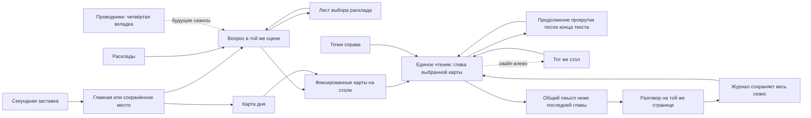

# ARCANUM: единый ритуал в Telegram Mini App

Статус: v5 принят владельцем для переноса в приложение 14 октября 2026; дополнения ниже также прямо запрошены владельцем. Учитывает последние правки: отдельная рамка, встроенные подписи, секундная заставка и непрерывное чтение. Заменяет v4 в спорных местах: английские подписи и вертикальная навигация, подтверждённое направление жеста — обычная прокрутка вниз. Приложенный интерактивный макет — самостоятельный черновик, не релиз приложения. Этот документ заменяет противоречащие ему визуальные решения первого среза после согласования. Техническую основу сессий и проверенные исправления первого среза сохраняем.

## Зачем меняем

ARCANUM — Telegram Mini App для женщин 25–40 лет: личный ритуал, глубокий разбор вопроса и немного общения с выбранным проводником. Владелец оценил первый интерфейс на 2/10: слишком светлая основа, слабые шрифты и композиция, плоские ассеты, разрозненные шаги. В локальной разработке вместо всего продукта ошибочно доступна ограниченная демонстрация. Следующий результат должен позволять пройти все восемь раскладов в обычном браузере и визуально возвращаться к исходному концепту.

Основания: прямые сообщения владельца; `Downloads/arcanum-project/assets/references/concept-premium-mobile.png`; исходные ART_DIRECTION, DESIGN_DOC, USER_FLOW. Документы концепта — референс, новые указания владельца имеют приоритет. Цвета Elden Ring даны владельцем как художественная интерпретация, не официальные токены игры.

## Уже задано владельцем

- Полный WebApp и весь пользовательский путь доступны локально, без страницы входа в Telegram и без ограничения тремя демонстрационными картами.
- Почти чёрная основа, заметные акценты проводников, типографика ближе к оригинальному концепту.
- Глубина собирается из независимых слоёв; большая готовая PNG на фоне не заменяет сцену.
- Карты сохраняют узнаваемые оригинальные сюжеты, композиции и подписи в собственном художественном стиле.
- Проводник выбирается в четвёртой нижней панели. При каждом раскладе выбора проводника нет.
- Переходы ощущаются продолжением одного ритуала, а не отдельными формами с кнопками «далее».
- Используем Superpowers и SDD. В установленном Superpowers это Subagent-Driven Development: исполнитель каждой задачи, независимая проверка спецификации и качества, затем обзор целого изменения.

## Решения, предложенные мной

Эти решения — интерпретация задания, а не ранее утверждённые владельцем требования.

1. Сохраняем существующие Next/React/TypeScript и Python/aiohttp/SQLite. Строим одну рабочую цепочку сессий для Telegram и локальной студии. Нового серверного фреймворка и микросервисов не требуется.
2. Основа иллюстраций — традиция Rider–Waite–Smith. При массовой отрисовке фиксируем символы, число предметов, позы и композицию каждой карты; номер и английское название генерируются в самом изображении; общая прозрачная рамка накладывается отдельным ассетом. Иллюстрация всегда показывается целиком, без обрезки и повторного названия в интерфейсе.
3. Для первого образца типографики: Forum для надписей и названий, IBM Plex Mono для короткого интерфейса и пробного чтения. Длинный текст проверяем отдельно: 16px, line-height 1.75. Точный шрифт растрового концепта не установлен. Если моноширинный длинный текст мешает чтению, основную гарнитуру меняем по результату сравнения реальных экранов, а не только font specimen.
4. Хранитель Руин — начальный проводник для композиции макета. Существующую настройку пользователя в приложении не заменяем. Новый аккаунт получает серверный default, которым может сразу пользоваться.
5. Пользователь может открыть любую карту. Открытие сразу ведёт к её чтению; обязательной кнопки «сначала перевернуть всё» нет. Общий синтез предлагается после знакомства со всеми картами, открытые карты всегда доступны повторно.
6. Локально по умолчанию используем подготовленные интерпретации через настоящий API и отдельную постоянную БД. Реальный OpenRouter — явный режим запуска с лимитом расходов, а не автоматическая реакция на найденный ключ.

## Композиция и типографика

Оптическая основа — чёрная пустота вокруг небольшого точного предмета. Главный экран не рекламная страница. Сверху компактная надпись «АРКАНУМ», затем длинная тихая световая ось с небольшим серпом, снизу короткая фраза и одно главное действие. Центральная композиция занимает место, но не освещает весь экран.

| Роль | Токен первого макета | Применение |
| --- | --- | --- |
| Пустота | `#050505` | Основная площадь экрана |
| Материал | `#0B0A09` | Очень слабая поверхность |
| Основной текст | `#E8E3D9` | Чтение и названия |
| Вторичный текст | `#B1A89A` | Подписи, пояснения |
| Тихий металл | `#6F5B3D` | Структура, часть гравировки |
| Старое золото | `#B99965` | Активная конструкция и малые блики |
| Странница Теней | `#ADA5D3` | Лунный аметист: маленький свет и фокус |
| Хранитель Руин | `#C7A369` | Латунь: маленький свет и фокус |
| Искра Хаоса | `#C87879` | Приглушённый кармин: маленький свет и фокус |

Выбор проводника меняет несколько смысловых акцентов, поведение света и голос. Базовый фон остаётся чёрным. Сухая олива, камень и ржавчина из палитры Elden Ring живут в материалах иллюстраций, не в общей зелёной подложке приложения. Контраст окончательно проверяется на реально набранных экранах; декоративный металл не используется для мелкого текста.

Название бренда 30–34px с разрядкой; названия экранов 26–30px; названия карт 22–26px; обычный текст 16px; подписи 12–13px. Капитель и разрядка служат короткой надписи на артефакте. Абзацы не набираются капсом, мелким серым шрифтом или широко разреженными буквами. На 320px размеры корректируются умеренно, чтение не мельчает. Минимальный размер интерактивной области 44px.

## Сцена как отдельные слои

Сцена состоит из двенадцати логических планов: чёрная пустота; дальний материал камня; задние выгравированные дуги; локальная боковая дымка; узкий свет за объектом; реликвия; принимающая поверхность стола; контактные тени; группы карт; ближние фрагменты, перекрывающие часть окружения; редкие точки пыли; неподвижный интерфейс. Глубина видна и без движения: разная резкость, перекрытия, физический материал и тени. Карта вместе с рамкой и тенью движется одним объектом.

Планы объединяются в три группы движения, а не двенадцать полноэкранных GPU-слоёв. Параллакс только от указателя на подходящем устройстве: примерно ±1/3/6px для дальнего/среднего/ближнего плана; на чтении, в скрытой вкладке и при reduced motion выключен. Датчики не нужны. В покое сцене не требуется бесконечная анимация.

Растровые материалы разрешены, но не содержат готовые луну, геометрию и интерфейс сразу. Они собираются вместе со светом, масками, SVG и предметами. Непрозрачная тёмная подложка защищает длинное чтение. Акцент проводника локальный, весь экран не перекрашивается. Подробный порядок, размеры и бюджеты — в `docs/design-work/scene-v4-design.md`; численные бюджеты являются предложением для проверки на мобильном устройстве.

## Карта пути

### Главная и вопрос

Четыре нижних раздела: Главная, Расклады, Журнал, Проводники. В покое они доступны постоянно. Во время чтения нижней панели нет. Справа вертикальные последовательные точки — по одной на карту, с активным состоянием и отметкой уже открытых. Видимые точки маленькие, область касания каждой не менее44×44px. Касание точки выбирает позицию. Стрелка вверху и свайп влево возвращают к столу; крестик закрывает сеанс на главную с сохранением места.

На главной «Задать вопрос» запускает основную цепочку. «Карта дня» — тихий короткий вход. Центральный знак при переходе к вопросу уменьшается и смещается вверх; пространство под ним становится местом записи. Заголовок «Что тебя занимает?», открытое текстовое поле, одна короткая подсказка. Черновик сохраняется при возврате.

Внизу вопроса показан текущий расклад и действие «изменить», открывающее нижний лист выбора. В листе — все восемь вариантов, их задача, число карт и компактная схема. Это часть подготовки вопроса, не отдельный экран настройки. Каталог во второй вкладке открывает вопрос с уже выбранным раскладом. Проводник здесь только подразумевается/подписан голосом; переключателя и скрытой отправки выбора нет.

### Создание и открытие

«Разложить карты» фиксирует вопрос и создаёт одну серверную операцию. Колода собирается в центре, затем раскладывается в выбранную геометрию. Анимация выдачи начинается после подтверждения фиксированных карт сервером. Нет выдуманной многосекундной загрузки, удержания кнопки или обязательного ручного тасования. Двойное касание и потеря ответа не создают второй расклад.

На столе три карты стоят рядом, как в референсе. Одна карта находится на оси. Шесть карт «Тени» образуют понятную последовательность пар. «Пентаграмма» имеет центр и пять позиций. «Подкова» формирует дугу из семи карт. Общая сетка одинаковых плиток не заменяет схемы. На узком экране позиция остаётся доступной кнопкой/списком; схема помогает ориентироваться, но не вынуждает читать мелкий текст.

Касание карты открывает её и перемещает тот же визуальный объект в крупную позицию чтения. Оставшиеся позиции становятся тихой навигацией. Нераскрытые карты не видны в accessibility tree как открытые. Стол доступен по желанию через свайп влево или стрелку в заголовке. Моё решение для реализации: системная кнопка Back сначала закрывает открытый лист; из чтения возвращает к столу с сохранением места. Крестик в заголовке закрывает сеанс на главную. Back не раскрывает новую карту. Историю браузера не используем как историю открытых карт. В disposable-прототипе проверены экранная стрелка и жест, интеграция Telegram Back остаётся задачей продукта. Когда текст ещё готовится, карту можно рассмотреть, а под ней появляется спокойное состояние ожидания; пользователь не обязан ждать на заблокированном столе.

### Чтение, смысл и разговор

Крупная целая карта в верхней части: номер и английское название уже в изображении, прозрачная общая рамка отдельным слоем. Далее позиция, связанная с вопросом интерпретация и короткая реплика проводника. Название карты повторно крупным текстом не выводится. Свайп может ускорять переход, но видимая навигация остаётся. Текст можно прокручивать без движения всей сцены; место чтения и выбранная позиция сохраняются.

Каждая выбранная карта — глава на одной поверхности чтения. Справа остаются точки позиций в порядке расклада, без нижнего dock или меню «позиции / следующая». Активная точка использует акцент проводника; открытые заполнены, закрытые контурные. Точки доступны пальцем, клавиатурой и скринридером; закрытые не раскрывают название скрытой карты.

Направление подтверждено владельцем: переход к следующей — продолжение прокрутки страницы вниз, то есть палец движется вверх. Пока текст не дочитан, это обычный вертикальный scroll. Новый жест, начатый уже в конце главы, открывает следующую неоткрытую позицию по порядку; после последней позиции поиск продолжается с первой закрытой. Жест, только что достигший конца, не переключает карту. Одна серия инерции не открывает несколько карт; остаточная прокрутка не проталкивает новое чтение. Точная дистанция и cooldown — настройка исполнителя после устройства: в образце64px для touch,90px накопленного wheel, разрыв серии240ms и блокировка перехода650ms.

Свайп влево возвращает к общему столу, сохраняя карты и место текста; верхняя стрелка делает то же. Он не вызывает новую генерацию. Вертикальный жест не перехватывается как горизонтальный, ввод/кнопки/выделение текста защищены. Для тех, кто не пользуется жестами, в конце главы есть тихое кликабельное «Продолжи вниз», а точки дают прямой переход. Это встроенная подсказка в тексте, не закреплённая панель.

Когда все карты открыты, под полным текстом текущей главы появляется общий смысл с небольшой схемой, затем обсуждение. Никакой автоматической смены экрана/прокрутки нет. Дальнейшая прокрутка естественно ведёт к этим разделам, вертикальный жест перестаёт открывать карты. Для одной карты — «На что обратить внимание» вместо повторного синтеза. Можно вернуться к любой открытой карте через точки и затем снова двигаться вниз. Сохраняются выбранная карта и место в главе/итоге/разговоре.

Разговор находится в той же странице под общим смыслом. Он привязан к сохранённому сеансу, исходному вопросу, картам и тому же проводнику. Не делается новый вытягивающий карты запрос. Уточнение можно связать с выбранной картой или всем раскладом; сервер получает идентификатор чтения и сам восстанавливает контекст. В журнале доступны исходное чтение и его обсуждение.

### Проводники

Единственное место выбора — четвёртая вкладка. Для каждого проводника: имя, несколько слов о манере общения, короткий пример одного и того же вопроса, свой знак и акцент. Выбранный проводник сохраняется на сервере и сразу доступен новому пользователю до первого расклада. Смена влияет на будущие сеансы; уже начатый расклад сохраняет свой голос. В макете все три голоса представлены подготовленными репликами; это не доказательство качества модели.

## Все восемь раскладов

| ID | Название | Карт | Подготовка |
| --- | --- | --- | --- |
| daily | Карта дня | 1 | Без вопроса; повтор открывает сегодняшнюю карту |
| single | Одна карта | 1 | Вопрос обязателен |
| three | Три карты | 3 | Вопрос можно пропустить; позиции из канонического ответа сервера |
| yesno | Да / нет | 3 | Вопрос обязателен; за, против, совет |
| mfd | Мысли · чувства · действия | 3 | Вопрос обязателен |
| shadow | Тень | 6 | Вопрос факультативен |
| pentagram | Пентаграмма | 6 | Вопрос обязателен; центр и пять стихий |
| horseshoe | Подкова | 7 | Вопрос обязателен |

Количество, ключи позиций, перевёрнутость и порядок соответствуют серверу. Неизвестный ID или отсутствие обязательного вопроса показывают ошибку в том же поле, а не незаметно меняют расклад. Кнопка вопроса доступна клавиатурой, выбор расклада не стирает текст.

## Локальная студия и реальный Telegram

Один поддерживаемый запуск из проекта поднимает frontend на `http://localhost:3210/` и Python API на loopback. Название команды и внутренняя реализация launcher фиксируются планом после согласования. Занятый порт обнаруживается явно; launcher завершает только свои процессы. Текущий адрес сохраняем, чтобы пользователю не приходилось искать новый экран.

В локальном режиме идентичность тестового аккаунта готовится автоматически до запросов и восстановления данных. Используются настоящие API-обработчики, полная колода из 78 карт, постоянная изолированная SQLite и подготовленные тексты. Доступны все типы расклада, открытие, чтение, разговор, журнал и настройки проводника. Отдельного пути «посмотреть демонстрацию» нет. Небольшая служебная панель вне композиции продукта сообщает режим и позволяет управлять тестовыми сбоями; технические пояснения не попадают в обычный путь пользователя.

Тестовые ответы явно различаются с ответами модели через служебную панель. Обычный старт не расходует ключи. Явный запуск с OpenRouter использует отдельную БД и конечный лимит вызовов/долларов; в бюджет входят внутренние повторы. Ключи только на Python-сервере. Текущий общий бюджет владельца $5 сохраняется с учётом прошлых probes. Бесплатный Zen остаётся выключенным по результату фактической ошибки провайдера.

Локальный API использует фиктивный Telegram signing token, регистрирует bootstrap только в явном dev-entrypoint и слушает loopback. Production сохраняет обычную проверку настоящего Telegram initData и ownership. Локальная идентичность не включается через query string или только проверку hostname. Production build не содержит локальных ключей, аккаунтов или маршрутов bootstrap. Обнаруженный `.env` не может переключить fixture в live. Поллинг Telegram, уведомления и платежи не запускаются при локальном тесте.

## Состояния и восстановление

Сервер — источник истины для вопроса, расклада, карт, ориентации, позиций, проводника, времени создания и текста. Браузер сохраняет черновик, выбранный экран, открытые карты и место чтения в пространстве текущего аккаунта/режима/экземпляра БД. Готовое чтение и обсуждение доступны из постоянной БД после перезапуска локального сервера.

- Пока исход begin не известен, повторяетcя та же операция. Уже выданная операция восстанавливается до чтения новой настройки проводника; изменение preference в другой вкладке не меняет старый расклад.
- Сбой сети сохраняет вопрос и прогресс. «Повторить соединение» не вытягивает новые карты и не запускает модель заново.
- Неудачная генерация допускает явный повтор чтения с теми же картами. У повторной попытки собственная идемпотентность и время запуска.
- Перезапуск локального API помечает его прерванные задачи как прерванные, сохраняя карты. Платные запросы автоматически не возобновляются. Production worker recovery — отдельная задача перед релизом, без предположения, что все processing-записи принадлежат одному процессу.
- Потерянный ответ на уточнение восстанавливается по идентификатору операции. Вопрос, ответ, guide snapshot и статус обсуждения хранятся с чтением. Ответ не дописывается к другому сеансу после навигации.
- Сброс dev-БД явный, меняет namespace. Сбой сети не трактуется как сброс аккаунта. Ошибка другого владельца не раскрывает закешированный чужой текст.
- Неудачный local fallback не выдаётся за полученный персональный ответ. Окончательные правила квоты и тарифа сохраняют отдельную маркировку и проверку перед платным запуском.

## Система карт и художественная проверка

Один общий формат, одна структура рамки, номер сверху и английское название снизу как в классической карте; иллюстрация занимает центральную плоскость. Номер сверху и английское название снизу генерируются внутри изображения. The Moon, The Hermit и The Fool — первые эталонные подписи. Язык рисунка не меняется с локалью приложения; доступное имя, значение позиции и текст чтения переводятся независимо по стабильному ID карты. Переключатель языка пока не входит в этот срез. Рамка — отдельный общий прозрачный ассет, наложенный на тот же холст 2:3. Никаких DOM-подписей поверх или обрезки изображения под окно. Доступное имя карты остаётся для скринридера. Старые временные карты с уже нарисованной рамкой не получают вторую поверх. Карта остаётся читаемой маленькой и при увеличении. Перевёрнутость поддерживается системой сеанса, не рисуется отдельной картинкой.

Сначала изучаем три карты разных типов композиции: Луна (животные, путь, башни), Шут (фигура, край обрыва, собака, цветок), Отшельник (фигура, фонарь, посох). В макете v5 три новые пробы с английскими названиями: Луна, Отшельник, Шут; остальные четыре рисунка временные из существующей колоды. Это не поставка всех 78 карт. После приёмки художественного языка выпускаем все 78 с карточной ведомостью и единым контролем символики. Массовая генерация до приёмки образцов не нужна. Возможность будущей смены skin отделяется от идентичности/смысла карты; магазин колод сейчас не проектируем.

Главный арт интерфейса и иллюстрации колоды — разные задачи. Даже качественный рисунок карты не превращается в полноэкранный hero. Источники, промпты, версии и права фиксируются в реестре; ассеты Elden Ring в продукт не переносятся.

## Движение и доступность

Обычный переход 220–320ms, раскрытие/переход карты 420–650ms. Конкретные значения можно отрегулировать после просмотра. Двигается связанный предмет; все абзацы не всплывают независимо друг от друга. На свежем запуске документа показывается заставка общей длительностью около 1000ms: 0–200ms появляется знак с названием, 200–600ms спокойная пауза, 600–1000ms знак и темнота растворяются в настоящем интерфейсе. Под заставкой восстанавливается нужный экран/место чтения; промежуточная главная не показывается. Моё решение для медленной сети: после секунды раскрываем спокойное состояние загрузки именно сохранённого чтения, не продлеваем заставку. При сбое там же доступны повтор соединения и выход на главную. Сохранённые карты не пересоздаются; точное место ставится после получения текста и загрузки его размеров. На переходах и возврате из фона заставка не повторяется. Она не подменяет загрузку и не задерживает уже открытое приложение. Нет звука, фиктивного прогресса и фокусируемых элементов. При reduced motion остаётся короткое простое растворение без трансформаций. В покое нет обязательного движения. При reduced motion — короткая смена состояния без параллакса/вращения, все функции сохранены. Фокус после открытия чтения переходит к заголовку/содержанию, после возврата — к соответствующей карте. Положение клавиатуры Telegram и safe areas проверяются на устройствах отдельно от desktop emulation.

## Критерии приёмки реализации

1. Обычный localhost без Telegram SDK injection открывает полное приложение с доступными четырьмя вкладками. Все восемь раскладов проходят до журнала; рабочий локальный API является тем же путём, которым пользуется E2E.
2. Выбрать проводника можно только в четвёртой вкладке. Новый пользователь сохраняет выбор до первого расклада. Старое чтение сохраняет свой голос после переключения.
3. Последняя карта не пропускается: полный текст сохраняется, ниже доступен общий смысл и разговор, без обязательного «К раскладу» и автоматического перехода. Продолжение прокрутки в конце переключает ровно одну карту, свайп влево возвращает на сохранённый стол, точки открывают нужную позицию. Нижней панели нет. Один вопрос проходит от записи до конкретной открытой карты и обсуждения без отдельной формы настройки проводника и без обязательного переворота всей колоды до чтения.
4. Проверены 1/3/6/7 карт, перевёрнутые и младшие арканы, реальные ключи позиций, все 78 URL изображений. Ошибка картинки не считается успешной проверкой колоды.
5. Повтор на потерянный begin, double tap, reload, недоступный API, остановка генерации, возврат из журнала и потеря ответа на уточнение не создают незаметно новый расклад/платный запрос.
6. Постоянные данные переживают локальный перезапуск; явный reset и недоступный сервер различаются. Fixture не обращается к моделям и Telegram даже при наличии настоящих секретов в окружении. Production не принимает local identity.
7. Визуальная проверка на 320/360/390/430px: нет переполнения, обрезанных подписей и недоступных целей; читаемая кириллица, контраст и reduced motion. Сравнение с исходным концептом по чёрному пространству, масштабу оси, композиции стола и крупной карте.
8. Заставка проверена на свежем запуске, восстановлении чтения и переходах: около секунды только при загрузке документа, без вспышки главной и заблокированных после неё кнопок.
9. Перед объявлением результата готовым: независимая проверка каждой задачи по спецификации и качеству, затем всего изменения; свежие тесты и screenshots. Число прошедших тестов само по себе не означает художественную приёмку.

## Порядок дальнейшей работы

После оценки этого дизайна: план с небольшими законченными задачами → локальная студия и источники состояния → сцена/типографика/переходы → все расклады и четвёртая вкладка → связанное чтение/обсуждение/журнал → интеграционная и визуальная проверка. Это одна переработка с зависимостями, а не несколько несвязанных экранов. SDD исполняет план без дополнительных остановок между задачами; reviewer не подменяет владельца в художественной оценке.

Новые тарифы, staging-бот, массовая художественная поставка всех 78 карт и production release остаются следующими проверяемыми этапами. Ничего из этого не объявляется сделанным по кликабельному макету.

## Приложенный 14 октября промпт

Использован как дополнительный checklist композиции, сохранения функциональности и визуальной проверки. Его общие требования не отменяют прямые новые указания владельца: подписи английские внутри изображения; рамка отдельным ассетом; проводник только в четвёртой вкладке; перед чтением нет повторного выбора проводника. Пункты про реальные UI-названия карт и отдельные кнопки перехода не переносятся вопреки этим решениям. Текущий макет остаётся черновиком для проверки поведения; функциональная реализация по существующему API следует согласованному плану SDD.

## Дополнение владельца после приёмки, 14 октября

Журнал заимствует структуру приложенного концепта: видимый месяц, переходы по месяцам, календарь с днями раскладов и список за выбранный период/день. Проводники представлены как три персоны: высокие портретные панели, характер и пример голоса. Выбор остаётся только в четвёртой вкладке.

Обратная навигация симметрична подтверждённой прокрутке вниз: обычная прокрутка к началу главы, отдельное дальнейшее движение вверх по странице возвращает к предыдущей карте; на первой остаётся на месте. Не перескакивает во время чтения. Это интерпретация направления по предыдущему уточнению владельца.

Небольшой вход в настройки не добавляет пятую вкладку. Сейчас доступны управление эффектами и существующей серверной настройкой уведомлений; звуковой движок не добавляем ради переключателя. Покрытие/материал интерфейса и акцент проводника архитектурно независимы. Будущие покрытия (включая приглушённое золото концепта), звуки, язык и дополнительные настройки не изображаются готовыми функциями.
